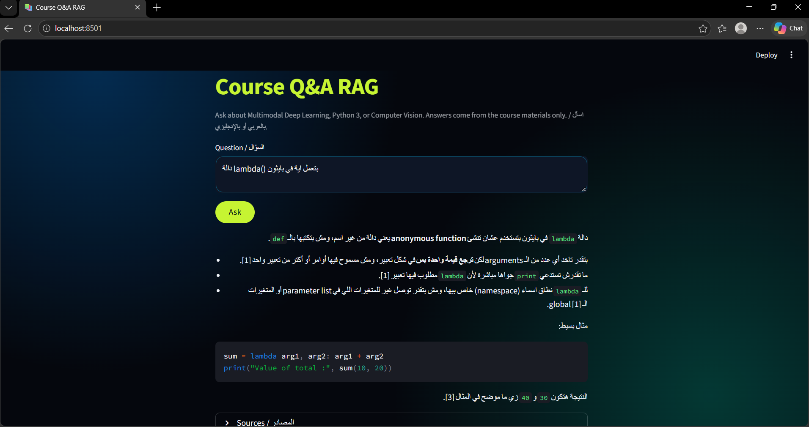

# Course Q&A RAG System

A Retrieval-Augmented Generation (RAG) system that answers student questions from the materials of three courses, stored in different file formats. Questions can be asked in **Arabic or English**, and answers are generated **only from the retrieved course content**, with source attribution.

**Live demo:**[ _add the Streamlit link here after deploying_](https://course-q-a-rag-system-yxfrhsdyuqc7n5zht9xgwa.streamlit.app/)



## Courses

| Course | Source format |
|---|---|
| Multimodal Deep Learning | `.docx` |
| Python 3 Tutorial | `.txt` |
| Computer Vision (Szeliski) | `.csv` |

Original materials were PDFs. They were extracted, cleaned, chunked (1,613 chunks in total), and then exported to the formats above to demonstrate multi-format ingestion.

## How It Works

1. **Load**: loaders for `.txt`, `.docx`, and `.csv` return chunks in one schema (`id`, `course`, `source`, `section`, `pages`, `text`).
2. **Index**: BM25 (lexical) and `BAAI/bge-small-en-v1.5` embeddings stored in ChromaDB (dense).
3. **Retrieve**: both rankings are merged with weighted Reciprocal Rank Fusion (BM25 weight 2, dense weight 1). BM25 is weighted higher because dense search alone missed chunks that contain rare keywords.
4. **Translate**: Arabic questions are translated to English before retrieval, since the materials are in English.
5. **Generate**: an LLM on Groq (`openai/gpt-oss-120b`) answers using only the top 8 passages, in the language of the question, citing passage numbers.
6. **Attribute**: the app lists the sources (course, section, pages, chunk id) under each answer.

If the passages do not contain the answer, the system says so instead of guessing.

## Project Structure

```
.
├── 01_extract.ipynb        # extract, clean, chunk, convert to txt/docx/csv
├── 02_rag.ipynb            # build the index, retrieval, LLM, evaluation
├── streamlit_app.py        # web app
├── requirements.txt
├── .streamlit/config.toml  # theme
└── data/raw_formats/       # course files used by the app
    ├── python_tutorial.txt
    ├── mdl_course.docx
    └── cv_course.csv
```

## Run Locally

```bash
pip install -r requirements.txt
```

Create a `.env` file in the project root:

```
GROQ_API_KEY=your_key_here
```

Get a free key at [console.groq.com](https://console.groq.com). Then run:

```bash
python -m streamlit run streamlit_app.py
```

The first run downloads the embedding model and builds the ChromaDB index (about a minute on CPU).

## Deploy (Streamlit Community Cloud)

1. Push the repository to GitHub.
2. Create a new app on [share.streamlit.io](https://share.streamlit.io) and select `streamlit_app.py`.
3. In **Advanced settings → Secrets**, add:

```toml
GROQ_API_KEY = "your_key_here"
```

## Re-running the Extraction

The source PDFs are not included in the repository. To re-run `01_extract.ipynb`, place them here:

```
multimodal_dl/mdl.pdf
python/Python - 3+ Version Tutorial.pdf
computer_vision/SzeliskiBookDraft_20210930.pdf
```

The converted files in `data/raw_formats/` are enough to run the app.

## Known Limitations

- The LLM occasionally adds small details that are not in the passages (for example, a code variant). The prompt discourages this, but it is not guaranteed.
- Chunks that only mention a topic in passing (for example, "Canny (1986)") can still be retrieved, so questions the books do not actually explain return "not found".
- Retrieval uses no reranker. A cross-encoder reranker was tested but did not improve results enough to justify the extra model.

## Tech Stack

Python · PyMuPDF · LangChain text splitters · rank_bm25 · sentence-transformers · ChromaDB · Groq · Streamlit
